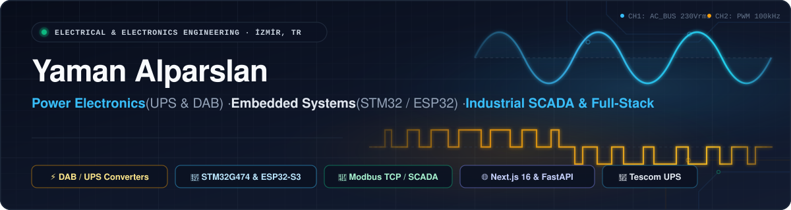
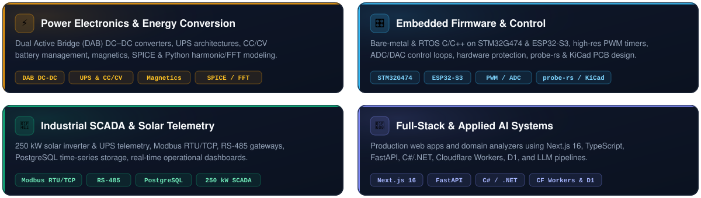

  

<h3 align="center">🛠️ Engineering Stack</h3>

  <strong>Embedded &amp; Hardware</strong> 
  
  
  
  
  
  
  

  <strong>Backend, SCADA &amp; Cloud</strong> 
  
  
  
  
  
  

  <strong>Frontend &amp; Data</strong> 
  
  
  
  
  
  
  

---

### ⚡ Core Engineering Domains

  

---

### 📌 Featured Public Repositories

| Repository | Stack &amp; Focus | Description |
| :--- | :--- | :--- |
| 🚀 [**`ekspertiz-rehberi`**](https://github.com/yamanalparslan/ekspertiz-rehberi) |    | Used-car inspection (*oto ekspertiz*) report analyzer combining LLM document extraction with deterministic safety rules and a D1 chronic-issue knowledge base. |
| 📡 [**`solar-monitor`**](https://github.com/yamanalparslan/solar-monitor) |    | 250 kW solar inverter SCADA &amp; telemetry system with Modbus TCP data acquisition, real-time analytics dashboard, and containerized deployment. |
| 🔋 [**`UpsDataSyncService`**](https://github.com/yamanalparslan/UpsDataSyncService) |   | Industrial UPS telemetry synchronization service and background worker engineered for Tescom UPS systems. |
| ⚡ [**`inverter-simulator-py`**](https://github.com/yamanalparslan/inverter-simulator-py) |   | Power electronics inverter circuit simulation, PWM waveform synthesis, and FFT harmonic distortion analysis. |
| 🚙 [**`ev-diagnostic-twin`**](https://github.com/yamanalparslan/ev-diagnostic-twin) |   | Electric vehicle digital twin and battery/drivetrain diagnostic telemetry simulator. |
| 🔌 [**`ChargEV-web`**](https://github.com/yamanalparslan/ChargEV-web) |   | EV charging station discovery and session planning web platform. |
| ⏱️ [**`ev-charging-estimator`**](https://github.com/yamanalparslan/ev-charging-estimator) |   | AC/DC electric vehicle charging curve and duration estimator based on battery capacity, SoC, and charger power. |

---

  ⚙️ Building reliable power hardware, deterministic firmware, and industrial telemetry systems from İzmir, Türkiye.

